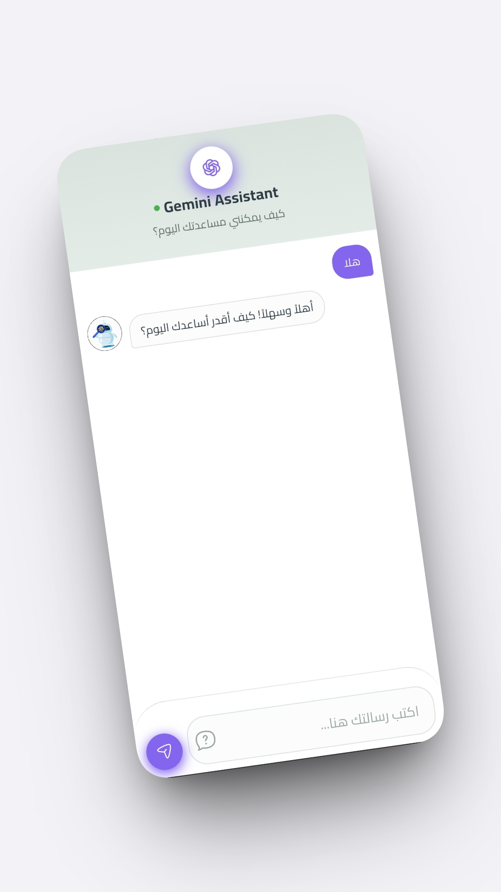
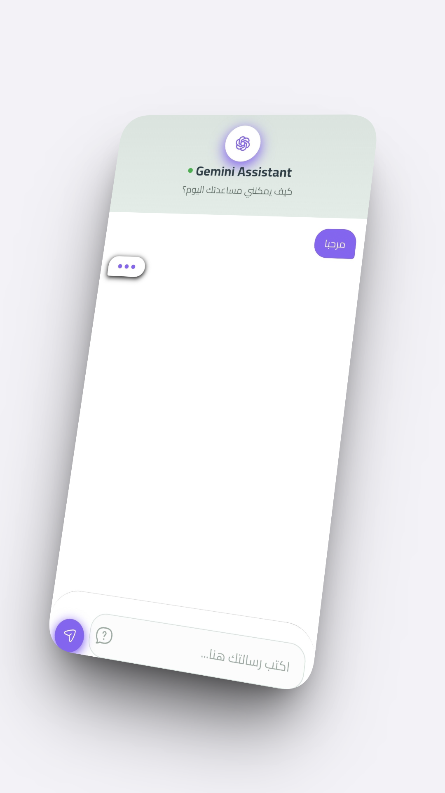
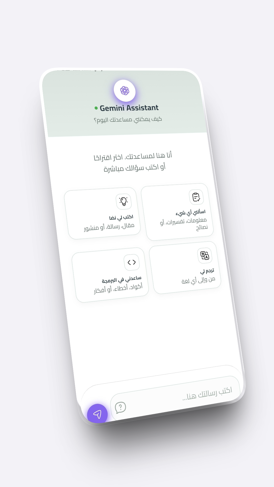
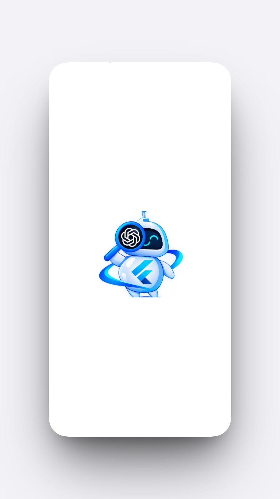

# 🤖 Gemini AI Chat Bot - Flutter Application

تطبيق محادثة ذكي ومتقدم يعمل بواسطة **Google Gemini API**، مبني باستخدام **Flutter** مع تطبيق مفاهيم **Clean Architecture** ونمط **Cubit** لإدارة الحالة بنظافة وقابلية للتوسع.

---

## 📸 معاينة التطبيق (Screenshots)

<div align="center">
  
  
  
  
</div>
---

## ✨ أهم المميزات (Key Features)

* 💬 **تفاعل فوري مع الذكاء الاصطناعي:** دمج نموذج `gemini-3.8-flash` للاستجابة السريعة والدقيقة.
* 🧠 **جلسات محادثة تفاعلية:** إدارة سياق الحوار واستكمال المحادثات بناءً على الرسائل السابقة عبر `ChatSession`.
* 🛡️ **إدارة متقدمة للأخطاء:** استخدام مكتبة `Dartz` لمنطق البرمجة الوظيفية (`Either<Failure, Success>`).
* 🏗️ **Clean Architecture:** فصل تام لطبقات التطبيق (Data, Domain, Presentation) لسهولة الصيانة والتطوير.
* ⚡ **إدارة حالة سلسة:** الاعتماد على `Flutter BLoC / Cubit` للتحكم في واجهات المستخدم بمرونة.

---

## 🛠️ التقنيات والمكتبات المستخدمة (Tech Stack)

| التقنية / المكتبة | الاستخدام |
| :--- | :--- |
| **Flutter / Dart** | إطار العمل واللغة الأساسية |
| **google_generative_ai** | المكتبة الرسمية للاتصال بـ Gemini API |
| **flutter_bloc** | إدارة حالة التطبيق (Cubit) |
| **dartz** | البرمجة الوظيفية ومعالجة الأخطاء (`Either`) |
| **get_it** | حقن التبعيات (Dependency Injection) |

---

## 📁 الهيكلية البرمجية (Project Structure)

```text
lib/
├── core/
│   ├── error/          # معالجة الفشل والأخطاء (Failures)
│   └── services/       # الخدمات العامة وتهيئة Gemini API
└── features/
    └── chat/
        ├── data/       # DataSources, Models, Repositories Implementation
        ├── domain/     # Entities, Repositories Interfaces, UseCases
        └── presentation/ # Cubits, Screens, Widgets